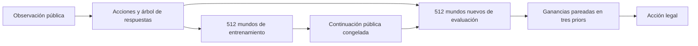

# v7: integrar respuestas y aprender continuaciones públicas

29 de octubre de 2026, hora de Lima. **v7 es experimental y v2 conserva el
valor predeterminado.** Se compara un cambio de estimador y de aprendizaje
de continuaciones. Las reglas oficiales siguen pendientes.

## Hipótesis y algoritmo

v5 considera una resubida all-in de un rival y aprende si el héroe debe
pagarla. Muestrea las respuestas rivales: una continuación pública poco
frecuente puede acumular pocos ejemplos y quedar en fold. La hipótesis de v7
es obtener más información de cada mundo de cartas, integrando todas las
respuestas posibles del mismo modelo y ponderando las continuaciones por
la probabilidad de alcanzarlas.

El nuevo módulo es [`integrated_response_search.py`](../pokerfight/integrated_response_search.py).
Conserva el menú de acciones de v5, sus tres priors de respuestas, la división
por mitades entre entrenamiento y evaluación, y los márgenes de selección.
Mantiene disponibles las subidas pequeñas, a diferencia de la restricción de v6.



Para una acción inicial `a`, un mundo de cartas `x` y una continuación pública
fija `π`, calcula:

\[
V_a(x;\pi)=\sum_r P(r\mid x,a)\,U(a,r,x;\pi).
\]

`r` incluye folds, calls y como máximo una resubida all-in rival. El árbol se
prepara una vez por observación. Vuelve a dar turno a los callers anteriores
si reciben esa resubida, respeta derechos de subida y all-ins cortos según
la abstracción existente, y liquida todas las capas del bote. Las probabilidades
de call dependen del precio y de callers anteriores en cada rama.

No se enumeran todas las cartas: siguen siendo mundos Monte Carlo de rangos
ponderados, condicionados a cartas disjuntas. Se consume el mismo flujo de
mundos y uniformes que v5 para permitir comparaciones del estimador. v7 ignora
los uniformes al integrar las respuestas.

## Continuación sin información privada de evaluación

Cada nodo de continuación `I` se identifica por jugador que resube, historial
hipotético público, contribuciones, jugadores retirados y costo del call.
La clave no contiene cartas rivales ni el resultado de showdown.

En un mundo de entrenamiento, `q_I(x)` es la probabilidad de llegar a ese nodo
y `g_I(x)` el valor incremental esperado de pagar en lugar de retirarse. La
estimación es el cociente:

\[
\hat\mu_I=\frac{\sum_i q_I(x_i)g_I(x_i)}{\sum_i q_I(x_i)}.
\]

Ponderar por alcance condiciona el rango de cartas a las acciones públicas
hipotéticas. Promediar sin esos pesos perdería esa información. Se usa:

\[
n_{\rm eff}=\frac{(\sum_i q_i)^2}{\sum_i q_i^2},\qquad
SE(\hat\mu)\approx
\frac{\sqrt{\frac{n}{n-1}\sum_i q_i^2(g_i-\hat\mu)^2}}{\sum_i q_i}.
\]

La aproximación de error corresponde al método delta para un estimador de
cociente. Se aprende call si hay al menos 16 mundos efectivos y la media menos
un error estándar supera 0,02 bb; los demás nodos quedan en fold. La política
aprendida se congela antes de generar los mundos de evaluación, que usan un
RNG independiente. Nunca se elige un call mirando los ranks de ese mundo de
evaluación.

Esa continuación congelada se usa para valorar escenarios dentro de la búsqueda.
En un turno real posterior el bot vuelve a calcular su decisión con la nueva
observación; no conserva un compromiso de ejecutar exactamente aquella tabla.
La política de continuación es, por tanto, otra aproximación del rollout y puede
diferir de la respuesta que finalmente se juegue.

Sobre la mitad de evaluación se comparan ganancias pareadas con la acción
local anterior a búsqueda. Como en v5, una alternativa debe superar 0,05 bb
tras restar dos errores estándar en los tres priors. Este umbral es una
heurística, no una garantía de confianza o de rentabilidad.

## Qué separan las pruebas

- La enumeración independiente ejecuta el rollout escalar de v5 por cada
  respuesta posible. Comprueba el valor integrado y el alcance y ganancia de
  todos los nodos públicos visitables en los fixtures, con política congelada.
- Otras pruebas cubren entrenamiento/evaluación incompletos, deadline,
  reproducibilidad, llamadas all-in baratas, manos legales de 2–6 jugadores y
  coincidencia entre proceso supervisado y ejecución directa.
- El benchmark de varianza usa la **misma continuación pública de siempre
  pagar** en ambos estimadores. Aísla la integración de respuestas del cambio
  de aprendizaje. Son siete estados, tres priors, 24 réplicas y 128 mundos por
  réplica. Se publican varianza y costo de CPU.
- La comparación de partidas mide el efecto conjunto de integrar respuestas
  y aprender con pesos de alcance. No permite atribuir una ganancia a uno de
  esos dos componentes por separado.

El [diseño previo](../results/integrated_shove_2026-10-29/design.json) precede a
las nuevas partidas. La [medición técnica](../results/integrated_shove_2026-10-29/stress_technical.json)
incluye 36 decisiones a 1.024 muestras para comprobar viabilidad antes de
registrar la matriz. Esa es la cuota predeterminada de v7 en la CLI, con
3.500 ms de presupuesto cooperativo y el supervisor local de 4.250 ms.

## Matriz registrada

El [protocolo congelado](../results/integrated_shove_2026-10-29/experiment/protocol.json)
registra a la vez piloto y comparación. Los workers importan su propia copia
de código, verificada por SHA-256. Se rechazan protocolos alterados, trazas
incompletas y reanudaciones con artefactos incompatibles.

| Versión | Política y cuota de esta matriz |
|---|---|
| v2 | Selección y fuentes congeladas; 4.000 muestras, 1.600 ms |
| v2mc | Misma selección congelada; cuota de 1.024, presupuesto de 3.500 ms |
| v4rb | Integración fold/call, sin resubida; hasta 1.024 mundos |
| v5 | Una resubida muestreada; 512 mundos de entrenamiento y 512 de evaluación |
| v6 | Modelo v4rb con alternativas terminales; hasta 1.024 mundos |
| v7 | Una resubida integrada y continuación ponderada; 512 + 512 mundos |

En las versiones con búsqueda, esa cuota de 1.024 corresponde a la búsqueda
adicional: antes se estima la equity de la decisión local con hasta otros
1.024 mundos. v2 y v2mc solo calculan su estimación de equity. Los conteos
de los logs separan mundos de equity, entrenamiento y evaluación de búsqueda.

En esta matriz v2mc tiene **menos** muestras que v2: su nombre histórico no
implica mayor precisión aquí. Los presupuestos de las candidatas son de
3.500 ms. Una misma cuota de cartas no equivale a un mismo costo de cálculo.

Se usan tres escenarios: presión de rivales de reglas, copias v2 con un perfil
explícito de 4.000 muestras, y mezcla externa Fullhouse/Honest/v2/pressure.
Honest es un rival educativo fold/call, y Fullhouse transfiere su modelo de
seis jugadores. NoRegrets queda fuera de esta matriz. Los rivales mantienen
las mismas cuotas y seeds entre todos los brazos.

Las manos con fichas reiniciadas cubren mesas de cinco y seis, profundidades
de 4, 8 y 12 bb y todas las rotaciones. El piloto fija dos bloques por celda;
la comparación, ocho. Cada bloque contiene todas las rotaciones de una baraja
y se trata como una unidad para inferencia.

Las sesiones de comparación usan cuatro grupos por escenario y formato,
todas las rotaciones y hasta 128 manos, con stack 800, ciegas fijas 50/100,
sin ante ni recompras. Los grupos completos son las unidades independientes.
Se publican fichas finales y eliminación acumulada a 24 y 128 manos. Un líder
en una mesa sin terminar no recibe una victoria artificial.

Se informan los 15 pares entre las seis versiones. Los intervalos bootstrap
de 5.000 réplicas tienen 95 % nominal, sin corrección por multiplicidad, y son
**exploratorios**. Se ponderan por igual celdas/escenarios/formatos. Se completan
ambas fases sin retocar parámetros ni detenerse por ganancias. No hay promoción
automática, aunque alguna media resulte favorable.

La auditoría reconstruye cada resultado desde sus trazas, verifica acciones
contra observaciones legales y repite desde el snapshot: bloque 0/rotación 0
de todas las celdas externas y grupo 0/rotación 0 de las sesiones externas,
todos los brazos y ambos formatos. Los replays no cuentan como evidencia nueva.

## Uso y reproducción

```powershell
.\.venv\Scripts\python.exe -m pokerfight decide examples/shortstack_search.json --policy v7
.\.venv\Scripts\python.exe -m unittest tests.test_integrated_response_search tests.test_integrated_shove_experiment -v
.\.venv\Scripts\python.exe -m scripts.benchmark_integrated_responses --output results/otra_medicion_varianza.json

# Para una campaña nueva, con ID y carpeta nuevos:
.\.venv\Scripts\python.exe -m scripts.integrated_shove_experiment register --root results/otra_integracion --id otro-id
.\.venv\Scripts\python.exe -m scripts.integrated_shove_experiment run --root results/otra_integracion --phase pilot
.\.venv\Scripts\python.exe -m scripts.integrated_shove_experiment summarize --root results/otra_integracion --phase pilot
.\.venv\Scripts\python.exe -m scripts.integrated_shove_experiment run --root results/otra_integracion --phase comparison
.\.venv\Scripts\python.exe -m scripts.integrated_shove_experiment summarize --root results/otra_integracion --phase comparison
.\.venv\Scripts\python.exe -m scripts.audit_integrated_shove --root results/otra_integracion --phase comparison
```

Se corrigió además la comparación por consola para separar presupuesto y
muestras del control y los rivales. Un control v2 ya no hereda el presupuesto
extendido de la candidata. El informe registra los perfiles del héroe y control
y el perfil solicitado a los rivales. Tipos como `v2_4000`, Honest y los rivales
de reglas conservan sus cuotas internas fijas, descritas arriba:

```powershell
.\.venv\Scripts\python.exe -m pokerfight evaluate --hero v7 --baseline v2 --opponents v2 --players 5 --blocks 8 --hands-per-block 1 --starting-stack 800 --experiment-id mi-comparacion --baseline-samples 4000 --baseline-budget-ms 1600 --rival-samples 4000 --rival-budget-ms 1600 --output results/mi-comparacion.json
```

Esta reparación de la CLI y del informe se hizo después de congelar la matriz;
los workers de la campaña siguen usando su snapshot y sus perfiles ya explícitos.
No se modificaron sus políticas, semillas ni cantidades.

## Límites

La integración elimina ruido de respuestas dentro del modelo, pero conserva
incertidumbre sobre cartas, rangos y priors. Una continuación rara puede tener
muchos mundos efectivos bajo un prior incorrecto: eso no valida dicho prior.
La abstracción permite una sola resubida all-in y omite apuestas posteriores.
La precisión de su expectativa no acredita que represente bien al rival real.
Las comparaciones locales y sus intervalos no predicen la clasificación oficial.
